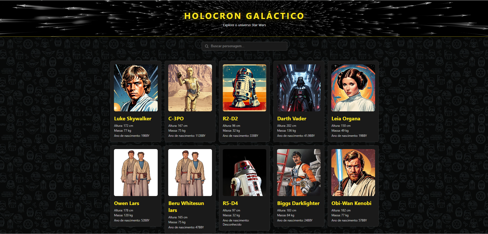

# Holocron Galáctico

Site para fãs de Star Wars feito com React, que lista personagens da saga, permite buscar por nome e mostra uma página de detalhes de cada um.



## Funcionalidades

- Lista de personagens com dados da SWAPI (Star Wars API)
- Busca em tempo real por nome
- Página de detalhes de cada personagem, com rotas dinâmicas
- Estados de carregamento e de erro, com botão "Tentar novamente"
- Mensagem amigável quando nenhum personagem é encontrado
- Características traduzidas para português, com explicação de BBY/ABY
- Layout responsivo com CSS Grid

## Tecnologias

- React
- Vite
- React Router
- CSS puro
- ESLint

## Como rodar o projeto

1. Clone o repositório:
```bash
   git clone https://github.com/Deidriane-amorim/holocron-galactico.git
```
2. Entre na pasta e instale as dependências:
```bash
   cd holocron-galactico
   npm install
```
3. Inicie o servidor de desenvolvimento:
```bash
   npm run dev
```

## O que aprendi

- Consumir uma API com `fetch`, `async/await` e tratamento de erros
- Gerenciar estado com `useState` e efeitos com `useEffect`
- Criar rotas dinâmicas com React Router (`useParams`)
- Organizar o código em componentes e funções utilitárias

## Autora

Feito por Deidriane Amorim

Projeto feito por fãs, sem fins lucrativos. Star Wars é marca da Lucasfilm/Disney.